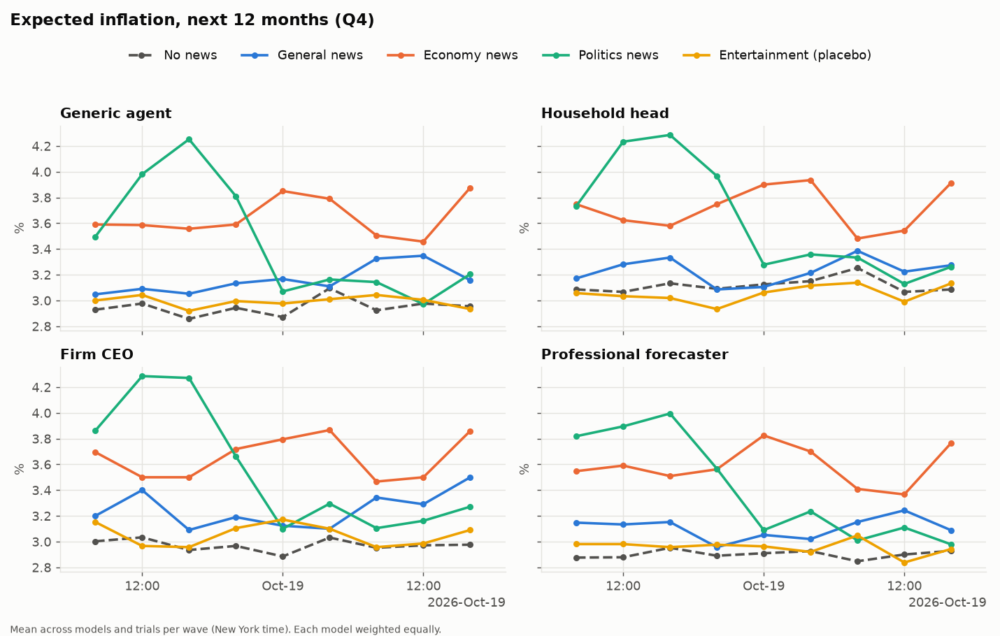
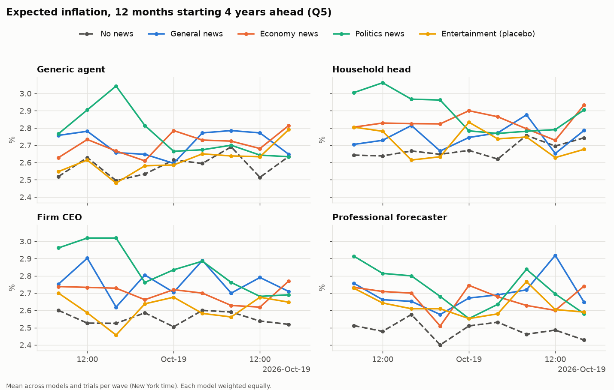
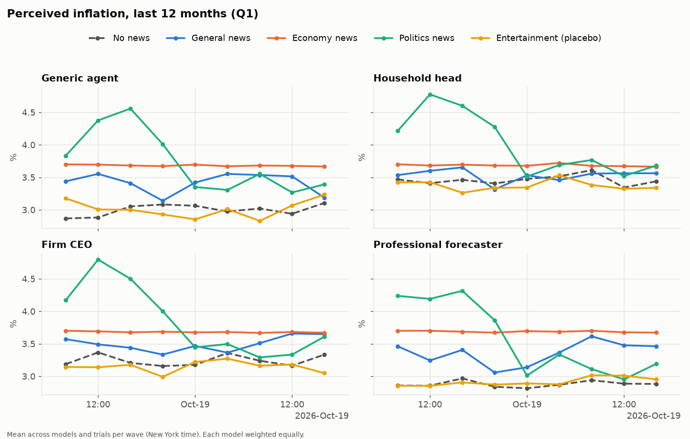
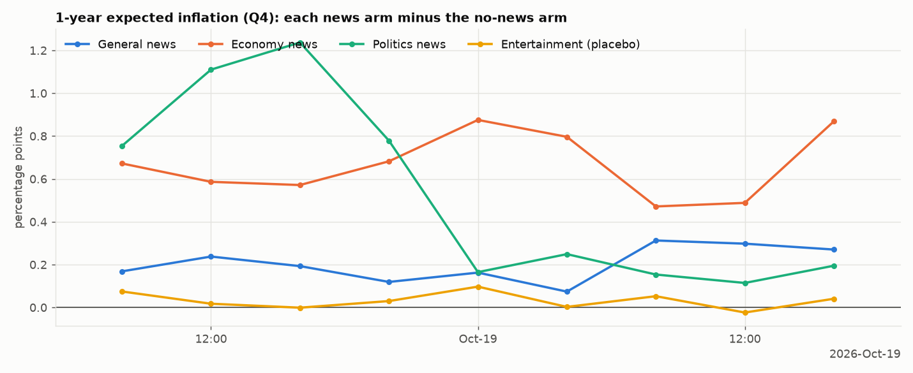
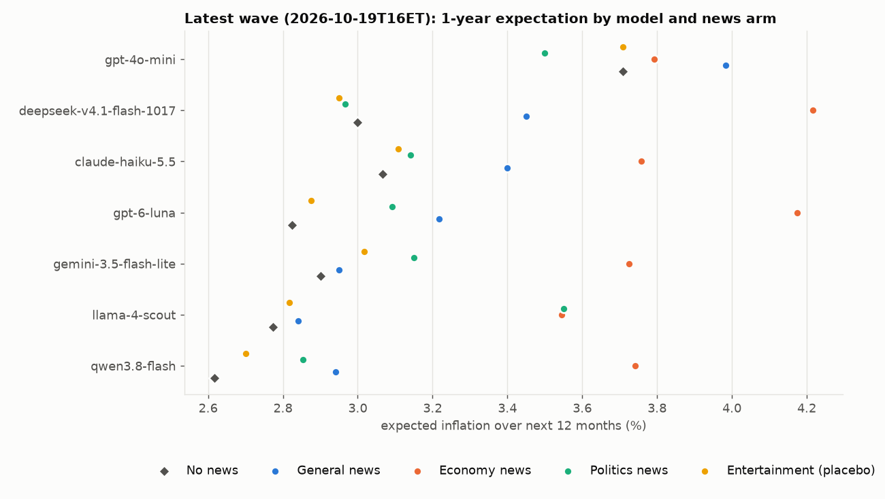
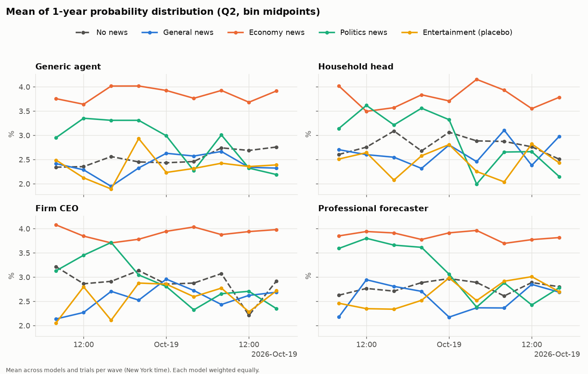
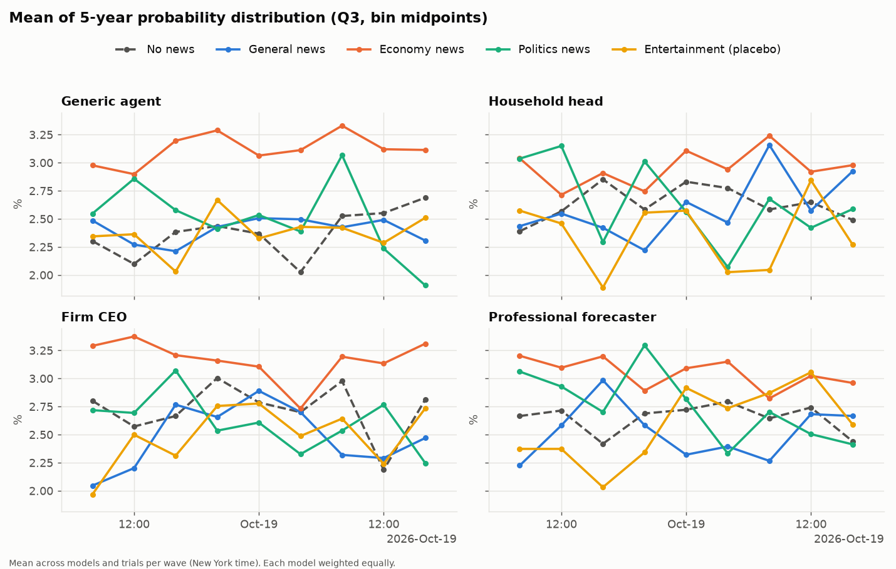
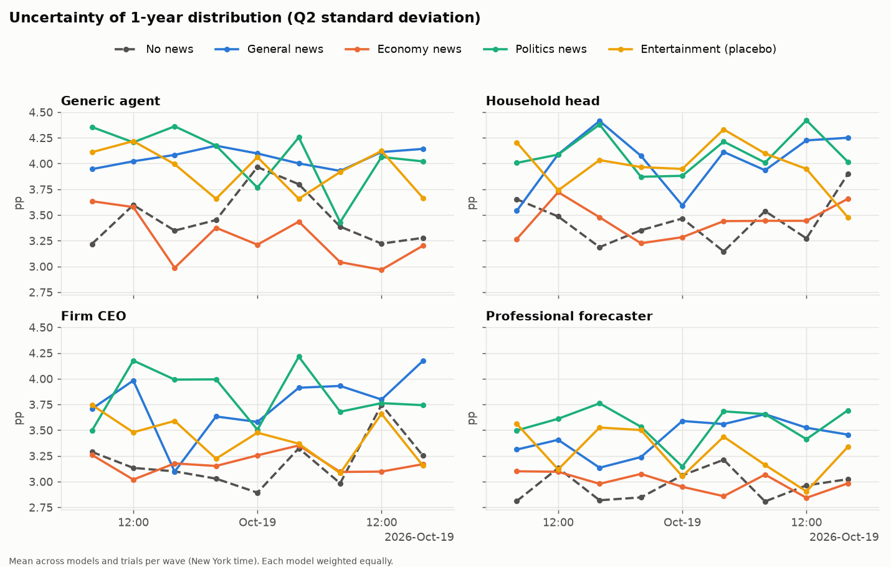
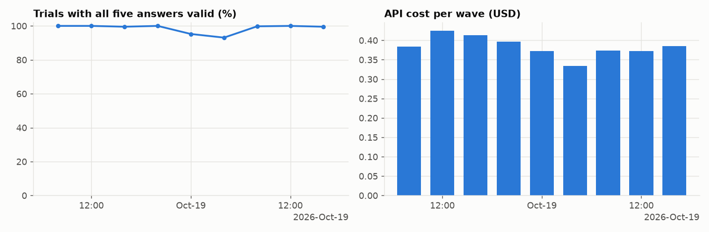

# AI High Frequency Inflation Expectations Panel

## Run calendar

<!-- CALENDAR:START -->
**Next scheduled wave:** **Mon Oct 19, 20:00 New York** (EDT) = **Tue Oct 20, 03:30 Tehran**  
**Completed waves:** 9 · calendar updated Oct 19, 17:04 New York / 00:34 Tehran (it refreshes after every wave)

Times in the cells are **Tehran time** for each New York slot. 🟢 completed · 🔴 missed · 🟡 due now · ⏳ next · ⚪ scheduled

| New York date | 00:00 ET | 04:00 ET | 08:00 ET | 12:00 ET | 16:00 ET | 20:00 ET |
|---|---|---|---|---|---|---|
| Tue Oct 20 | ⚪ 07:30 | ⚪ 11:30 | ⚪ 15:30 | ⚪ 19:30 | ⚪ 23:30 | ⚪ 03:30 (+1d) |
| Mon Oct 19 | 🟢 07:30 | 🟢 11:30 | 🟢 15:30 | 🟢 19:30 | 🟢 23:30 | ⏳ 03:30 (+1d) |
| Sun Oct 18 | · | · | 🟢 15:30 | 🟢 19:30 | 🟢 23:30 | 🟢 03:30 (+1d) |
<!-- CALENDAR:END -->

Every four hours (00, 04, 08, 12, 16, 20 New York time) this repository surveys seven AI models
about U.S. inflation, under five information conditions and four respondent personas. Questions
follow the New York Fed Survey of Consumer Expectations. Everything is saved: the news the models
were shown, every prompt, every raw reply, and the parsed answers.

**Live website:** https://alizarif.github.io/hf-ai-inflation-expectations/ (all waves over time, each wave in detail, and the method; rebuilt after every wave)

<!-- STATUS:START -->
**Latest wave:** `2026-10-19T16ET` · 420 trials · 418 fully valid · 32 had a probability list rescaled to 100 · cost $0.385  
**Waves so far:** 9 · **rows in panel:** 3780 · **total cost:** $3.45
<!-- STATUS:END -->

## Design

| | |
|---|---|
| **Models** (7) | `openai/gpt-6-luna`, `openai/gpt-4o-mini`, `deepseek/deepseek-v4.1-flash-1017`, `qwen/qwen3.8-flash`, `meta-llama/llama-4-scout`, `google/gemini-3.5-flash-lite`, `anthropic/claude-haiku-5.5` |
| **Personas** (4) | generic (no role) · household ("Act as the head of a household in the US.") · firm ("Act as the CEO of a US firm.") · forecaster ("You are a professional forecaster.") |
| **Information arms** (5) | `none` (no news) · `general` (top headlines) · `economy` (U.S. economy / inflation / prices) · `politics` (U.S. politics) · `entertainment` (placebo) |
| **Trials** | 3 independent single-call conversations per model × persona × arm → **420 calls per wave** |
| **Questions** | Q1 perceived inflation (last 12 months) · Q2 / Q3 ten-bin probability distributions (next 12 months; months 48–60) · Q4 / Q5 point forecasts for the same horizons. Text is in [`hfie/questions.py`](hfie/questions.py). |

**How a wave runs**

1. **One shared news search per topic.** A single OpenRouter call per topic uses the Exa web-search
   tool (about $0.007 per search). Every result (title, URL, excerpt) is captured to `news.json`.
   Each model in an arm gets exactly the same news text. If the search returns fewer than 3 results,
   the runner falls back to Google News RSS, and the manifest records which source was used.
2. **One message per trial.** The system prompt (with the persona) and one user message (news, if
   any, then Q1–Q5 in order) are sent together, and the model answers all five questions in one reply.
   Each model runs at its default temperature and reasoning settings.
3. **One call per trial, no follow-up.** Answers are parsed from the labelled lines; the prompt says each
   probability list must have ten numbers totalling 100. A list that still misses 100 (by more than 0.1) is
   rescaled proportionally to 100: the raw sum is kept in `q2_sum_raw` / `q3_sum_raw` and the row is flagged
   `rescaled`. A sum outside 50–150, or an unreadable answer, is recorded as invalid and never re-asked.
4. **Charts and panel** are rebuilt from all waves and committed.

System prompt (`config.yaml`):

> You are taking part in a survey about inflation expectations about the U.S. economy. Today is {date}, {hour}:00 UTC. {persona} Answer each question with your own best estimate; there are no right or wrong answers. Reply with your answer only, in exactly the format the question asks for.

The topic searches never mention that a survey about inflation follows.

## Files

```
config.yaml                     the whole study design (models, personas, arms, prompts, search, budget)
hfie/                           code: questions, schedule, openrouter, news, prompts, parse, run_wave, panel, charts
data/waves/YYYY/MM/DD/<wave>/   one folder per wave
    manifest.json               config hash, timing, lateness, status counts, news sources, cost
    news.json                   every captured search result + the exact news text shown per arm
    raw.jsonl.gz                every API request and full response (search + every trial)
    responses.csv               parsed answers, one row per trial
data/panel/panel_YYYY-MM.csv    all waves stacked (one row per trial), split by month
data/waves_index.csv            one row per wave (quality, cost, news sources)
charts/                         regenerated after every wave
web/                            the public website (static HTML + D3); hfie/site.py writes its JSON data
data_test/, charts_test/        output of manual test runs (kept out of the panel)
```

Key columns in `responses.csv`: `q1`, `q4`, `q5` (percent); `q2_p0..q2_p9`, `q3_p0..q3_p9` (bin
probabilities, ordered from "deflation ≥12%" to "inflation ≥12%"); `q2_mean`, `q2_sd`, `q3_mean`,
`q3_sd` (descriptive, using bin midpoints with open bins closed at ±16%); `q2_p_above4`,
`q2_p_deflation`; `status` (`ok` = all five answers valid), `rescaled`, `q2_sum_raw`, `q3_sum_raw`, `problems`; token counts,
`cost_usd`, and `returned_model` / `provider`.

## Charts











## Running it

**Setup:** add the repository secret `OPENROUTER_API_KEY` (Settings → Secrets and variables → Actions).
The schedule then runs by itself.

**Manual runs:** Actions → *Survey wave* → *Run workflow*:
- `test`: real API calls with 1 trial per cell (140 calls). Output goes to `data_test/` and isn't part of the panel.
- `production`: a real wave for the current slot, the same as a scheduled run. Tick *force* to redo a slot.
- `dry-run`: simulated answers with no API calls. The output is attached to the run as an artifact.

**Locally:**
```sh
pip install -r requirements.txt
python -m pytest -q                                   # unit tests + simulated end-to-end wave
python -m hfie.run_wave --mode dry-run                # simulated wave -> data_dryrun/
OPENROUTER_API_KEY=... python -m hfie.run_wave --mode test
python -m hfie.charts                                 # rebuild panel + charts from data/
```

**Cost guard:** a wave stops making calls once it has spent `runtime.max_wave_cost_usd` ($5 by default).
At list prices, a full wave of these seven models should cost well under $1.

## Notes for analysis

- Each wave is indexed by its **scheduled** New York slot (`wave_id`, e.g. `2026-10-18T04ET`), not by
  when it ran. GitHub cron often starts late; the delay is recorded as `lateness_minutes`.
- News is common to all models within an arm and wave, so the 420 trials are **not** 420 independent
  news shocks. Cluster or bootstrap by wave (× arm) when estimating treatment effects.
- Trials measure the sampling variation of each model at its default settings. They are not human respondents.
- If a model is withdrawn from OpenRouter, its calls fail and are recorded as `failed`. To drop it,
  remove it from `config.yaml`; this changes the design hash recorded in every later wave.
